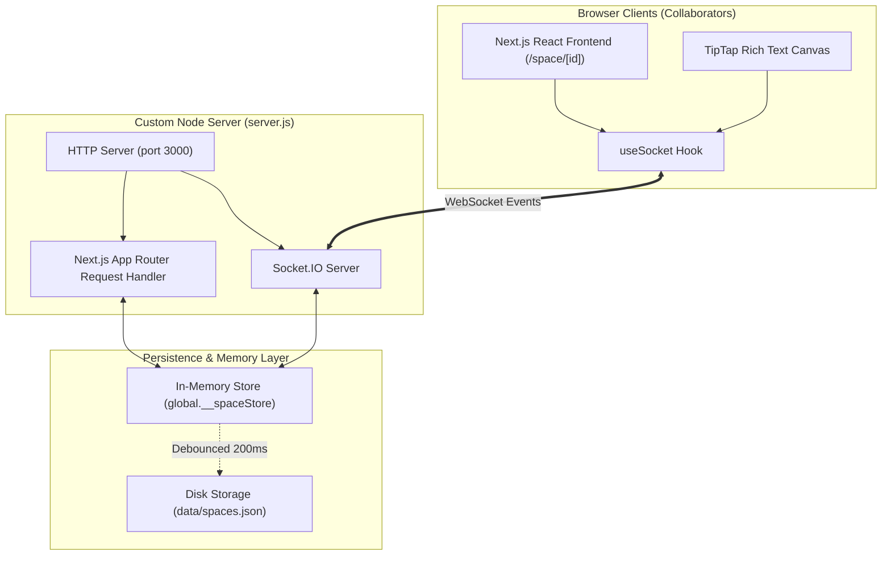

# 000001 — Initial Architecture & Implementation of Real-Time Collaborative Spaces

- **Document ID**: `000001-init`
- **Feature**: Real-Time Collaborative Space Editor (Google Docs Clone)
- **Status**: Complete & Verified
- **Date**: 2026-10-10
- **Stack**: Next.js 14 (App Router), Socket.IO, TipTap (ProseMirror), Tailwind CSS, TypeScript, Node.js

---

## 1. Overview & Objectives

The goal was to create a minimalist, real-time collaborative text editor where:
1. **Spaces Lifecycle**: Users can create temporary or permanent "spaces" (documents/rooms) with customized or auto-generated names, share them via direct links, and permanently destroy them at will.
2. **Real-Time Collaboration**: Multiple participants can join the same space simultaneously, edit with sub-millisecond latency, view collaborator presence (avatars, typing indicators), and maintain conflict-resilient document states.
3. **Space Destruction Ejection**: When any participant triggers space destruction, the room and its files are permanently purged, and all connected participants are immediately notified with an animated modal and redirected back to the dashboard.
4. **Simple & Elegant Text Editor**: A Google Docs-inspired interface with rich-text formatting (headings, lists, blockquotes, code blocks, alignments, highlights, undo/redo) and multi-format export (Markdown, Plain Text, HTML, Print/PDF).

---

## 2. System Architecture



---

## 3. Storage Layer (`src/lib/spaceStore.ts` & `data/spaces.json`)

### 3.1 Dual-Layer Storage Pattern
1. **In-Memory Store (`global.__spaceStore`)**:
   - Holds active spaces and real-time room collaborator maps (`spaceId -> socketId -> Collaborator`).
   - Enables zero-latency document reads and writes during rapid keystrokes without disk I/O bottlenecks.
2. **Disk Persistence (`data/spaces.json`)**:
   - The memory store automatically debounces writes (200ms) to `data/spaces.json`.
   - Persists spaces across server reboots.
   - When a space is destroyed, it is removed from both memory and disk immediately.

### 3.2 Data Schema
```typescript
export interface Space {
  id: string;               // e.g. "orbit-breeze-445", "welcome-space"
  title: string;            // Document title
  content: string;          // TipTap HTML representation
  plainText?: string;       // Plain-text snippet for preview cards
  createdAt: string;        // ISO 8601 timestamp
  updatedAt: string;        // ISO 8601 timestamp
  creatorName?: string;     // Creator display name
}

export interface Collaborator {
  id: string;               // Persistent local user ID
  socketId?: string;        // Active socket identifier
  name: string;             // Display name (e.g., "Swift Falcon")
  color: string;            // Vibrant hex color for avatars/cursors
  joinedAt: number;         // Timestamp of joining
  isTyping?: boolean;       // Current typing status
}
```

---

## 4. Real-Time Communication Protocol (`Socket.IO`)

The WebSocket server runs inside [`server.js`](file:///C:/Users/Yash%20Shekhar/Desktop/Projects/docscollab/server.js) attached to the primary Node HTTP server.

### 4.1 Event Catalog

| Event Name | Direction | Payload | Description |
| :--- | :--- | :--- | :--- |
| `join-space` | Client -> Server | `{ spaceId, user }` | Sockets joins room `space:${spaceId}`. Server initializes presence. |
| `space-init` | Server -> Client | `{ space, collaborators }` | Initial document state and participant list sent to the connecting user. |
| `collaborator-joined` | Server -> Client | `{ user, collaborators }` | Broadcast to existing participants in the room. |
| `collaborator-left` | Server -> Client | `{ userId, collaborators }` | Broadcast when a socket disconnects or leaves. |
| `content-change` | Client -> Server | `{ spaceId, content, plainText, senderId, version }` | Sent by editor on input change. |
| `content-update` | Server -> Client | `{ content, plainText, senderId, version, updatedAt }` | Broadcast to all **other** clients in the room (echo suppressed). |
| `title-change` | Client -> Server | `{ spaceId, title, senderId }` | Emitted when document title is renamed. |
| `title-update` | Server -> Client | `{ title, senderId }` | Broadcast to update title in all clients. |
| `typing-indicator` | Client -> Server | `{ spaceId, userId, isTyping }` | Emitted on typing start and debounced stop (1.2s). |
| `typing-update` | Server -> Client | `{ userId, isTyping }` | Displays *"X is typing..."* banner. |
| `cursor-move` | Client -> Server | `{ spaceId, userId, cursor, name, color }` | Emitted on selection / caret move. |
| `cursor-update` | Server -> Client | `{ userId, cursor, name, color }` | Broadcast to position collaborator markers. |
| `destroy-space` | Client -> Server | `{ spaceId, userId, userName }` | Deletes space from memory & disk; broadcasts destruction. |
| `space-destroyed` | Server -> Client | `{ spaceId, destroyedBy }` | Emitted to **all** clients in the space. Triggers modal + auto-redirect. |

---

## 5. Client Components Breakdown

### 5.1 Editor Engine ([`CollaborativeEditor.tsx`](file:///C:/Users/Yash%20Shekhar/Desktop/Projects/docscollab/src/components/editor/CollaborativeEditor.tsx))
- **Base**: `@tiptap/react` and `@tiptap/starter-kit`.
- **Extensions**:
  - `Underline`
  - `Highlight` (multicolor)
  - `TextAlign` (left, center, right, justify)
  - `Placeholder`
- **Echo Suppression & Cursor Preservation**:
  - Uses an internal flag `isLocalUpdateRef` to prevent re-broadcasting remote updates.
  - When applying remote HTML via `editor.commands.setContent(remoteContent, { emitUpdate: false })`, current user selection is bounded and preserved.
- **Metrics**: Computes word count, character count, and reading time in real-time.

### 5.2 Document Toolbar ([`EditorToolbar.tsx`](file:///C:/Users/Yash%20Shekhar/Desktop/Projects/docscollab/src/components/editor/EditorToolbar.tsx))
- Google Docs-inspired header ribbon.
- Direct formatting commands: Undo, Redo, Headings selector (H1, H2, H3, Normal), Bold, Italic, Underline, Strikethrough, Highlight, Alignment buttons, Lists, Quotes, Code Blocks, and Clear Formatting.
- **Export Menu**:
  - Plain Text (`.txt`)
  - Markdown (`.md`)
  - Styled HTML (`.html`)
  - Print / PDF (`window.print()`)

### 5.3 Space Header & Presence ([`SpaceHeader.tsx`](file:///C:/Users/Yash%20Shekhar/Desktop/Projects/docscollab/src/components/space/SpaceHeader.tsx))
- Inline editable title with instant auto-save and remote sync.
- Active collaborator avatar stack with presence pulse and typing indicators.
- User profile picker (customizable nickname + avatar/cursor color).
- Share modal trigger.
- **Destroy Space** action button.

### 5.4 Modals & Safety Controls
- **[`DestroyConfirmModal.tsx`](file:///C:/Users/Yash%20Shekhar/Desktop/Projects/docscollab/src/components/space/DestroyConfirmModal.tsx)**: Danger-styled confirmation preventing accidental space deletion.
- **[`SpaceDestroyedAlert.tsx`](file:///C:/Users/Yash%20Shekhar/Desktop/Projects/docscollab/src/components/space/SpaceDestroyedAlert.tsx)**: Displayed to all users when a space is destroyed. Displays who triggered the deletion, counts down 4 seconds, and automatically redirects to the dashboard.
- **[`ShareModal.tsx`](file:///C:/Users/Yash%20Shekhar/Desktop/Projects/docscollab/src/components/space/ShareModal.tsx)**: Copyable direct URL and Room ID.
- **[`UserProfileModal.tsx`](file:///C:/Users/Yash%20Shekhar/Desktop/Projects/docscollab/src/components/space/UserProfileModal.tsx)**: User profile customization persisted to browser `localStorage`.

---

## 6. REST API Endpoints

- `GET /api/spaces`: Returns list of all active spaces sorted by `updatedAt` with active online collaborator counts.
- `POST /api/spaces`: Creates a new space with `{ title, creatorName }`.
- `GET /api/spaces/[id]`: Returns space metadata and content. Returns 404 if not found or destroyed.
- `DELETE /api/spaces/[id]`: Permanently destroys space from disk and memory, and emits `space-destroyed` socket event to any lingering clients.

---

## 7. Verification & Integration Testing

An automated integration script [`scripts/test-collab.js`](file:///C:/Users/Yash%20Shekhar/Desktop/Projects/docscollab/scripts/test-collab.js) was constructed to test end-to-end functionality:
1. Creates space via `POST /api/spaces`.
2. Connects two independent `socket.io-client` instances to simulate two distinct collaborators.
3. Tests joining and receiving `space-init`.
4. Emits `content-change` from Client 1; verifies Client 2 receives `content-update`.
5. Emits `destroy-space` from Client 1; verifies both Client 1 and Client 2 receive `space-destroyed`.
6. Checks `GET /api/spaces/[id]` to confirm HTTP 404 purge.

Result: **100% Passed**.

---

## 8. Directory Structure Summary

```
docscollab/
├── data/
│   └── spaces.json                # Persisted storage for spaces
├── doc/
│   └── 000001-init.md             # This implementation document
├── scripts/
│   └── test-collab.js             # Automated multi-client test script
├── src/
│   ├── app/
│   │   ├── api/spaces/route.ts
│   │   ├── api/spaces/[id]/route.ts
│   │   ├── space/[id]/page.tsx
│   │   ├── globals.css
│   │   ├── layout.tsx
│   │   └── page.tsx
│   ├── components/
│   │   ├── editor/
│   │   │   ├── CollaborativeEditor.tsx
│   │   │   └── EditorToolbar.tsx
│   │   └── space/
│   │       ├── DestroyConfirmModal.tsx
│   │       ├── ShareModal.tsx
│   │       ├── SpaceDestroyedAlert.tsx
│   │       ├── SpaceHeader.tsx
│   │       └── UserProfileModal.tsx
│   ├── hooks/
│   │   └── useSocket.ts
│   └── lib/
│       ├── spaceStore.ts
│       └── user.ts
├── server.js                      # Custom Next.js + Socket.IO server
├── package.json
├── tsconfig.json
└── README.md
```
