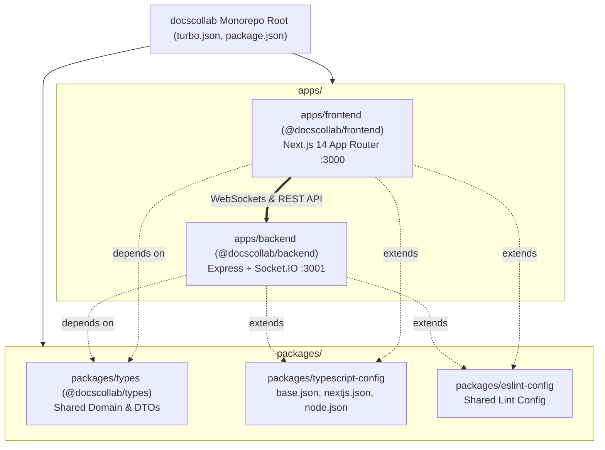

# 000002 — Turborepo Monorepo Architecture & Modular Production Setup

- **Document ID**: `000002-turborepo-architecture`
- **Feature**: Monorepo Architecture with Turborepo, Dedicated Backend & Frontend Apps
- **Status**: Complete & Verified
- **Date**: 2026-10-10
- **Package Manager**: npm workspaces (`npm@10.9.8`)
- **Orchestration**: Turborepo (`turbo@2.4.4` / `2.11.x`)

---

## 1. Overview & Monorepo Migration

The project was migrated from a single Next.js custom server application into a modular, production-ready **Turborepo Monorepo** featuring two independent applications and shared packages:

1. **`apps/frontend`**: High-performance Next.js 14 App Router application providing the real-time Google Docs-inspired collaborative editing interface, toolbar, active presence indicators, and space lifecycle controls.
2. **`apps/backend`**: Dedicated Node.js + Express + Socket.IO server handling room management, real-time WebSocket multiplexing, REST API endpoints, and dual-layer data persistence.
3. **`packages/types`**: Shared TypeScript domain entities, DTOs, and WebSocket event payloads (`@docscollab/types`).
4. **`packages/typescript-config`**: Centralized tsconfig presets (`base.json`, `nextjs.json`, `node.json`).
5. **`packages/eslint-config`**: Shared linting configurations (`base.js`).

---

## 2. Monorepo Architecture Diagram



---

## 3. Workspaces & Directory Structure

```
docscollab/
├── apps/
│   ├── backend/
│   │   ├── src/
│   │   │   ├── config.ts              # Port, Host, CORS, DataDir config
│   │   │   ├── index.ts               # Express & Socket.IO server entry
│   │   │   ├── routes/
│   │   │   │   ├── healthRouter.ts    # GET /health
│   │   │   │   └── spacesRouter.ts    # REST endpoints (/api/spaces)
│   │   │   ├── socket/
│   │   │   │   └── socketHandler.ts   # WebSocket room management
│   │   │   └── store/
│   │   │       └── spaceStore.ts      # Dual-layer storage (memory + disk)
│   │   ├── package.json               # @docscollab/backend
│   │   ├── tsconfig.json              # Extends node.json
│   │   └── .eslintrc.json
│   │
│   └── frontend/
│       ├── src/
│       │   ├── app/
│       │   │   ├── layout.tsx         # Root layout with fonts & metadata
│       │   │   ├── page.tsx           # Dashboard & Spaces gallery
│       │   │   └── space/[id]/
│       │   │       └── page.tsx       # Live document workspace
│       │   ├── components/
│       │   │   ├── editor/
│       │   │   │   ├── CollaborativeEditor.tsx  # TipTap canvas
│       │   │   │   └── EditorToolbar.tsx        # Formatting toolbar
│       │   │   └── space/
│       │   │       ├── DestroyConfirmModal.tsx
│       │   │       ├── ShareModal.tsx
│       │   │       ├── SpaceDestroyedAlert.tsx
│       │   │       ├── SpaceHeader.tsx
│       │   │       └── UserProfileModal.tsx
│       │   ├── hooks/
│       │   │   └── useSocket.ts       # Real-time WebSocket hook
│       │   └── lib/
│       │       └── user.ts            # Local identity helper
│       ├── next.config.mjs            # Rewrites /api/* to backend
│       ├── package.json               # @docscollab/frontend
│       ├── tailwind.config.ts
│       └── tsconfig.json              # Extends nextjs.json
│
├── packages/
│   ├── types/
│   │   ├── src/index.ts               # Space, Collaborator, DTOs
│   │   └── package.json               # @docscollab/types
│   ├── typescript-config/
│   │   ├── base.json
│   │   ├── nextjs.json
│   │   └── node.json
│   └── eslint-config/
│       └── index.js
│
├── data/
│   └── spaces.json                    # Debounced disk storage
├── doc/
│   ├── 000001-init.md                 # Initial implementation doc
│   └── 000002-turborepo-architecture.md # Turborepo migration doc
├── scripts/
│   └── test-collab.js                 # Multi-client integration test
├── turbo.json                         # Turborepo task pipeline
├── package.json                       # Monorepo root workspaces
├── .prettierrc
└── .prettierignore
```

---

## 4. Turborepo Task Pipelines (`turbo.json`)

```json
{
  "$schema": "https://turbo.build/schema.json",
  "tasks": {
    "build": {
      "dependsOn": ["^build"],
      "outputs": [".next/**", "!.next/cache/**", "dist/**"]
    },
    "lint": {
      "dependsOn": ["^lint"]
    },
    "check-types": {
      "dependsOn": ["^check-types"]
    },
    "dev": {
      "cache": false,
      "persistent": true
    }
  }
}
```

---

## 5. Available Scripts

From the root of the repository:

| Command                | Action                                                                                                              |
| :--------------------- | :------------------------------------------------------------------------------------------------------------------ |
| `npm run dev`          | Runs both `@docscollab/backend` (port 3001) and `@docscollab/frontend` (port 3000) concurrently in development mode |
| `npm run build`        | Builds all packages and apps for production using `tsup` and `next build`                                           |
| `npm run check-types`  | Executes TypeScript typechecking across all monorepo packages                                                       |
| `npm run lint`         | Runs ESLint across all apps and packages                                                                            |
| `npm run format`       | Runs Prettier to format all TypeScript, JSX, JSON, and Markdown files                                               |
| `npm run format:check` | Verifies code formatting with Prettier                                                                              |
| `npm run test:e2e`     | Runs the automated multi-client Socket.IO integration test                                                          |

---

## 6. Verification Status

- **Typecheck (`npm run check-types`)**: ✅ Passed (3 packages, 0 errors).
- **Lint (`npm run lint`)**: ✅ Passed (0 warnings, 0 errors).
- **Build (`npm run build`)**: ✅ Passed (`@docscollab/backend` + `@docscollab/frontend` built).
- **Format (`npm run format:check`)**: ✅ Passed (All files match Prettier code style).
- **Automated E2E Test (`npm run test:e2e`)**: ✅ Passed (Multi-client real-time sync & space destruction).
